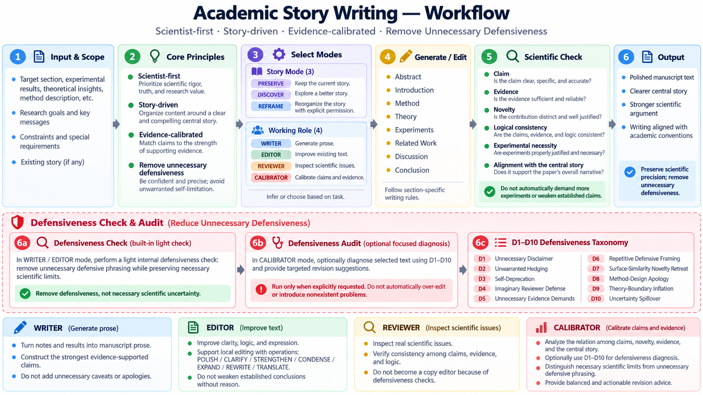

# Academic Story Writing

**Write like a scientist, not like an author defending against an imaginary reviewer.**

A **Codex Skill for CS / AI / ML research writing**. Turn research notes into paper-ready prose, strengthen an argument without inventing evidence, or revise only a selected sentence, paragraph, or LaTeX passage.

**Scientist-first · Story-driven · Evidence-calibrated**

[简体中文](README.zh-CN.md) · [Quick start](#quick-start) · [Before & after](#before--after-controlled-experiment) · [Workflow](#workflow) · [Capabilities](#where-it-helps) · [Examples](#examples)

## Quick start

From the root of a local checkout of this repository, install the Skill into your paper project:

```bash
mkdir -p /path/to/paper/.agents/skills
cp -R skills/academic-story-writing /path/to/paper/.agents/skills/
```

On Windows, copy `skills/academic-story-writing/` to `<paper-project>/.agents/skills/academic-story-writing/` using File Explorer or PowerShell. Then start or refresh your Codex session.

For example, turn experimental notes into a Results paragraph:

```text
$academic-story-writing
PRESERVE + WRITER. Turn these notes into a concise Results paragraph.
State what the controlled comparison shows and how it supports our main story.
Keep the claim within the measured setting. Do not invent results or objections.

[Paste experiment notes]
```

Or edit only the passage you select:

```text
$academic-story-writing
PRESERVE + EDITOR. POLISH only this LaTeX paragraph.
Keep formulas, citations, values, technical meaning, and warranted confidence.

[Paste selected paragraph]
```

## Why this exists

Research writing should present **what a paper contributes and why the evidence supports it**. An AI assistant can instead drift into preemptive reviewer defense: weakening established results, apologizing for standard components, repeating what a theorem does *not* prove, or demanding more seeds and datasets without tying them to the actual claim.

Academic Story Writing separates **constructive scientific writing** from **reviewer-style critique**. It preserves justified confidence and corrects concrete scientific problems; it also rejects unsupported novelty, guarantees, and performance claims. The objective is a clear, coherent scientific story—not either extreme.

## Before & after: controlled experiment

*Illustrative example; all measurements are fictional.* An ablation uses dataset D, the same split, training protocol, evaluation metric, and random seed. The only specified change is whether module X is enabled. Accuracy is **81.2% with X** and **79.8% without X**.

**Overdefensive:**
> Although the improvement may reflect dataset-specific characteristics, additional datasets and random seeds are required before we can draw conclusions.

**Evidence-calibrated:**
> Under the matched evaluation protocol on dataset D, enabling module X increases accuracy from 79.8% to 81.2%, a gain of 1.4 percentage points. This result supports the contribution of X in the evaluated configuration.

The comparison establishes an observation **within the tested setting**; it is not a claim about average performance across random seeds or generalization to other datasets. Those stronger claims would require appropriate additional evidence. [See the full example →](examples/experimental-writing.md)

## Workflow

**From the user's editing scope to a focused validity check—without silently switching into reviewer mode.**



[Open the full-resolution workflow](assets/workflow.png)

The workflow preserves two independent choices: **story mode** (`PRESERVE` by default, `DISCOVER`, `REFRAME`) determines whether the central framing may change; **working role** (`WRITER`, `EDITOR`, `REVIEWER`, `CALIBRATOR`) determines the task. Review or reframing is not silently activated during ordinary writing.

## Where it helps

| Research task | What the Skill prioritizes |
|---|---|
| **Experiments / Results** | Report controlled comparisons directly; distinguish within-setting findings, stochastic variability, and generalization. |
| **Method** | Explain formulations, mechanisms, and design choices without defensive apologies for standard components. |
| **Theory** | Lead with established results; retain the exact assumptions, quantifiers, and proof boundaries. |
| **Introduction / Related Work** | Build a central story and compare substantive contributions rather than surface-level similarities. |
| **Draft → prose** | Construct the strongest defensible claim from notes, equations, outlines, and recorded results. |
| **Local editing** | Polish, clarify, strengthen, condense, expand, or rewrite only the authorized LaTeX/text selection. |

Across these tasks, the Skill checks **claim construction, unjustified claim downgrades, evidence requirements, disclaimers, and novelty**. Every highlighted advantage should serve the paper's central scientific thesis.

## Examples

- [Experiments: controlled ablation → Results](examples/experimental-writing.md)
- [Method: standard backbone, meaningful formulation](examples/method-writing.md)
- [Theory: lead with the proved result](examples/theory-writing.md)
- [Local editing: improve one LaTeX paragraph](examples/local-editing.md)

All examples are synthetic. The Skill can support scientific writing, but it cannot independently guarantee proof correctness, accurate citations, or sound statistical inference. When the evidence does not justify a proposed claim, it should preserve the strongest supported version and identify the concrete gap.

## Contributing

See [CONTRIBUTING.md](CONTRIBUTING.md) for suggestions and issue reports. Reproducible cases that include the requested task, supporting evidence, an unwanted rewrite, and a better scientifically faithful alternative are especially helpful. Please do not submit confidential manuscript or review content without permission.

## License

Licensed under the [MIT License](LICENSE).